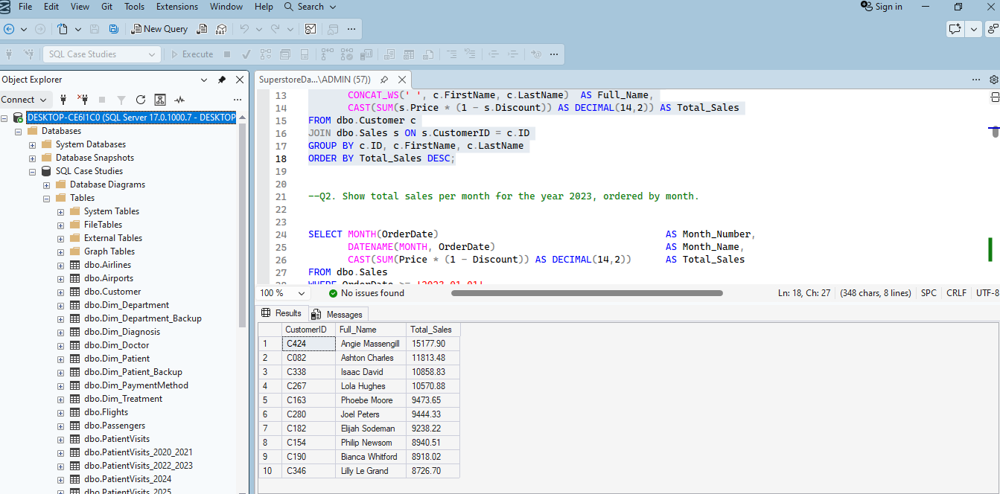
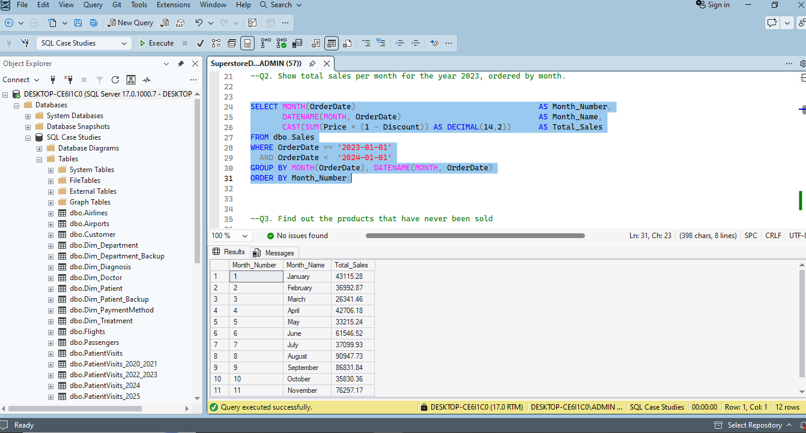
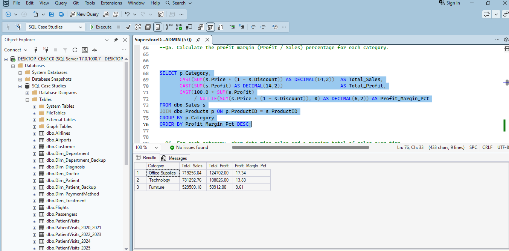
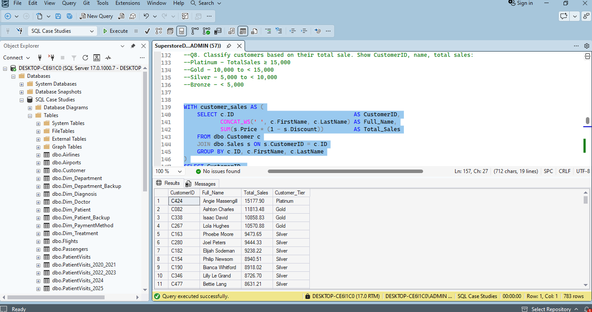
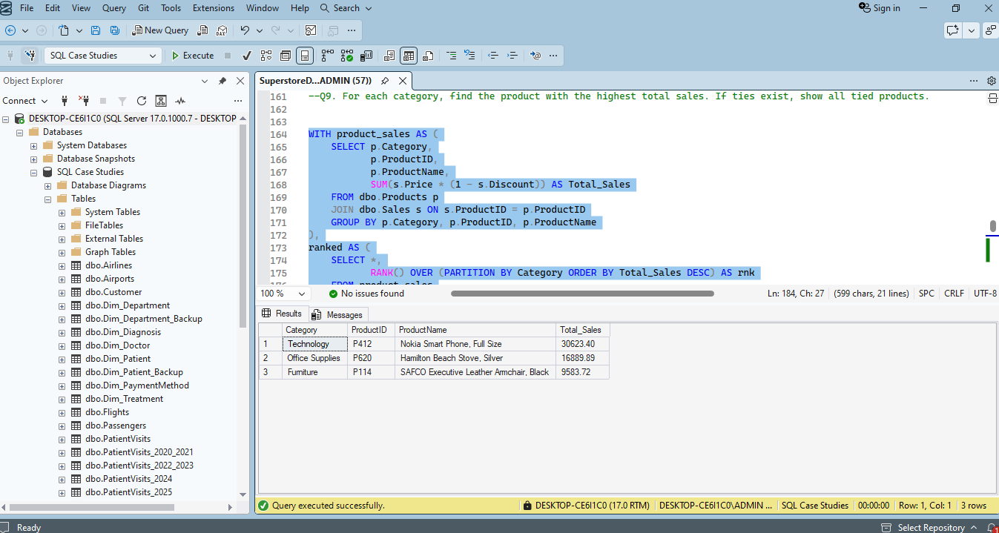
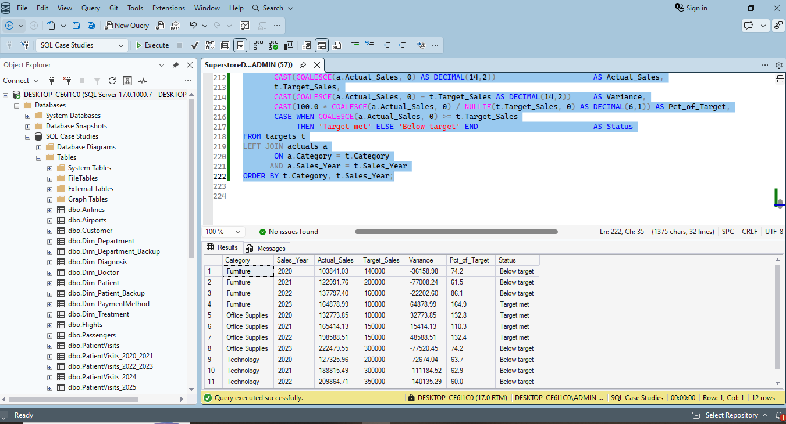

# Superstore Data Analysis | SQL Server

## Project Overview

This project focuses on analyzing Superstore sales data using Microsoft SQL Server. The objective is to extract business insights related to sales performance, customer behavior, product performance, and profitability.

## Business Objectives

- Identify the highest-value customers based on total sales.
- Analyze monthly sales performance.
- Identify products that have never been sold.
- Measure new customer acquisition.
- Evaluate profit margins by product category.
- Analyze cumulative sales performance over time.
- Identify the most recent order for each customer.
- Segment customers based on total sales.
- Identify top-selling products in each category.
- Compare actual sales against sales targets.

## SQL Analysis

This project demonstrates:

- SQL SELECT, WHERE, GROUP BY, and ORDER BY
- INNER JOIN and LEFT JOIN
- Aggregate functions
- Common Table Expressions (CTEs)
- CASE statements
- Window functions (ROW_NUMBER, RANK, SUM OVER)
- Date functions
- Customer segmentation
- Sales performance analysis

## Analysis Results & Screenshots

### 1. Top 10 Customers by Total Sales

### 2. Monthly Sales

### 3. Profit Margin by Category

### 4. Customer Segmentation

### 5. Top-Selling Products by Category

### 6. Actual vs Target Sales by Category and Year

## Tools & Technologies

- Microsoft SQL Server
- SQL Server Management Studio (SSMS)
- SQL

## Project Structure

- SQL/ – SQL scripts for data analysis.
- Screenshots/ – Screenshots of SQL queries and results.

## Author

Abdurrahim

Data Analyst | Business Intelligence Enthusiast
